# Uber Ride Analysis (2016)

A data science project on one rider's Uber trip log for 2016. It covers data preprocessing, exploratory data analysis (ride patterns, peak hours, fare trends, anomalies) and a machine-learning model that forecasts daily ride demand.

**Tools:** Python, Pandas, NumPy, Matplotlib, Seaborn, Scikit-learn, Jupyter

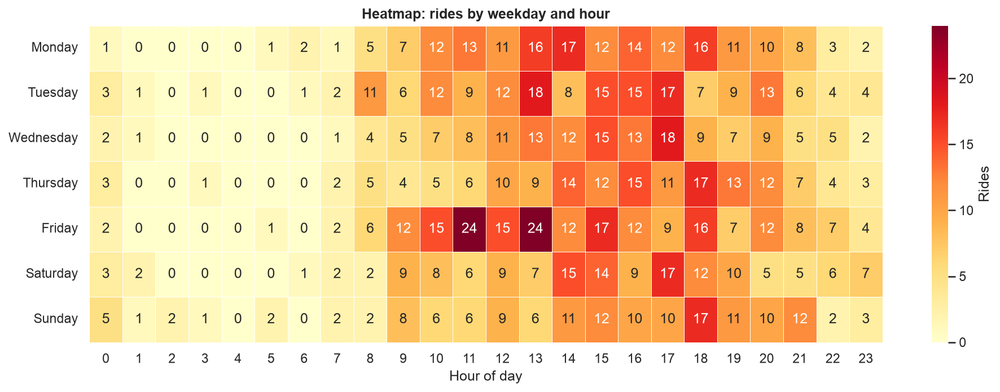

---

## Contents

1. [Project structure](#1-project-structure)
2. [How to run](#2-how-to-run)
3. [Dataset](#3-dataset)
4. [Approach](#4-approach)
5. [Data preprocessing](#5-data-preprocessing)
6. [Summary statistics](#6-summary-statistics)
7. [Key insights and visualizations](#7-key-insights-and-visualizations)
8. [Ride-demand forecasting model](#8-ride-demand-forecasting-model)
9. [Challenges](#9-challenges)
10. [Possible improvements](#10-possible-improvements)
11. [Business applications](#11-business-applications)

---

## 1. Project structure

```
Uber_Ride_Analysis/
├── data/
│   └── uber_drives_2016.csv          # raw dataset
├── src/uber_analysis/
│   ├── preprocessing.py              # cleaning, feature engineering, fare estimate
│   ├── visualization.py              # every chart (saved as PNG)
│   └── forecasting.py                # demand-forecasting features, models, metrics
├── notebooks/
│   ├── Uber_Ride_Analysis.ipynb      # main notebook, executed, with all outputs
│   ├── build_notebook.py             # regenerates the notebook
│   └── early_work/                   # first-draft EDA and regression notebooks
├── reports/
│   ├── figures/                      # 15 charts used in this README
│   ├── results.json                  # cleaning log, statistics, model metrics
│   ├── uber_rides_clean.csv          # cleaned data with engineered features
│   ├── purpose_summary.csv
│   ├── numeric_summary.csv
│   └── forecast_test_predictions.csv
├── run_analysis.py                   # runs the full pipeline
└── requirements.txt
```

## 2. How to run

```bash
git clone https://github.com/Haranvs/Uber-Ride-Analysis.git
cd Uber-Ride-Analysis
python -m venv .venv && source .venv/bin/activate   # Windows: .venv\Scripts\activate
pip install -r requirements.txt

python run_analysis.py                 # rebuilds reports/ and all figures
jupyter notebook notebooks/Uber_Ride_Analysis.ipynb
```

## 3. Dataset

**Source:** *My Uber Drives - 2016* (public Kaggle dataset, file `data/uber_drives_2016.csv`). It is one Uber user's trip history for 2016. Most trips are in North Carolina, USA (Cary, Morrisville, Raleigh, Durham), with a few trips in Pakistan (Islamabad, Lahore, Karachi).

| Column | Type | Description |
|---|---|---|
| `START_DATE*` | datetime | Trip start (`m/d/yyyy h:mm`) |
| `END_DATE*` | datetime | Trip end |
| `CATEGORY*` | category | `Business` or `Personal` |
| `START*` | text | Pickup location |
| `STOP*` | text | Drop-off location |
| `MILES*` | float | Trip distance in miles |
| `PURPOSE*` | category | Meeting, Meal/Entertain, Customer Visit, and others. Often blank |

The raw file has 1,156 rows. The last row is a `Totals` line, not a trip.

> **No fare column.** The dataset has no prices. To study pricing, the project uses an **estimated fare** from an assumed UberX-style rate card: $2.00 base + $1.00/mile + $0.20/minute + $1.50 booking fee, with a $6.00 minimum. The rates are set in `FARE_RATES` in `preprocessing.py`. Fare trends therefore reflect distance and duration, not real surge pricing.

## 4. Approach

1. **Load and clean** the raw CSV. Every cleaning step is logged (section 5).
2. **Feature engineering:** hour, weekday, month, time of day, weekend flag, duration, average speed, round-trip flag, distance band and estimated fare.
3. **EDA:** ride patterns by hour, weekday and month; heatmaps; daily time series; purposes and locations; distance and duration distributions; anomaly detection; fare trends.
4. **Forecasting:** turn the trips into a daily demand series (366 days, with days that had no rides counted as 0). Then train and compare baseline and ML models with a time-ordered train/test split.
5. **Report:** figures, metrics and this README are all generated from the same code.

## 5. Data preprocessing

| Step | Action | Rows affected |
|---|---|---|
| 1 | Remove the `Totals` summary row | 1 removed |
| 2 | Parse dates with an explicit `%m/%d/%Y %H:%M` format | 0 failed |
| 3 | Drop exact duplicate trips | 1 removed |
| 4 | Fill a missing `PURPOSE` with **"Unspecified"**. Dropping these rows would lose 43% of the data, and the blanks mean "not tagged", not missing trips | 502 filled |
| 5 | Clean text values and fix the encoding error `Kar?chi` → `Karachi` | — |
| 6 | Remove trips whose end time is at or before the start time | 4 removed |
| 7 | **Flag, not drop:** very long trips (above Q3 + 3×IQR, about 33 miles) | 46 flagged |
| 8 | **Flag, not drop:** average speed above 80 mph (likely a wrong timestamp or distance) | 19 flagged |

The final clean dataset has **1,150 trips**. The anomalies stay in the data but are marked with `is_long_trip_outlier` and `is_speed_anomaly`, so they can be shown in the charts or filtered out.

## 6. Summary statistics

| Metric | Value |
|---|---|
| Trips | 1,150 (1 Jan to 31 Dec 2016) |
| Total distance | 12,120 miles |
| Distance per trip | mean 10.5 mi, median 6.0 mi |
| Duration per trip | mean 23.3 min, median 16.5 min |
| Median average speed | 21 mph |
| Business trips | 93.3% |
| Trips with a recorded purpose | 56.7% |
| Round trips (same start and stop location) | 24.7% |
| Rides per day | mean 3.1, max 13. 74 days had no rides |
| Estimated spend for the year | about $21,500 (mean $18.73, median $13.00 per ride) |

Average trip by purpose (from `reports/purpose_summary.csv`):

| Purpose | Rides | Avg miles | Avg minutes | Avg est. fare |
|---|---|---|---|---|
| Unspecified | 498 | 9.7 | 23.2 | $17.85 |
| Meeting | 186 | 15.3 | 29.8 | $24.73 |
| Meal/Entertain | 160 | 5.7 | 16.1 | $12.44 |
| Errand/Supplies | 128 | 4.0 | 13.0 | $10.16 |
| Customer Visit | 101 | 20.7 | 33.4 | $30.88 |
| Temporary Site | 50 | 10.5 | 25.9 | $19.15 |

## 7. Key insights and visualizations

### Peak hours: 1 pm to 6 pm
Demand starts rising at 8 am. The four busiest hours are **3 pm, 5 pm, 6 pm and 1 pm**. Almost half of all rides (48%) start between 1 pm and 6 pm, and only 3% start between midnight and 6 am.

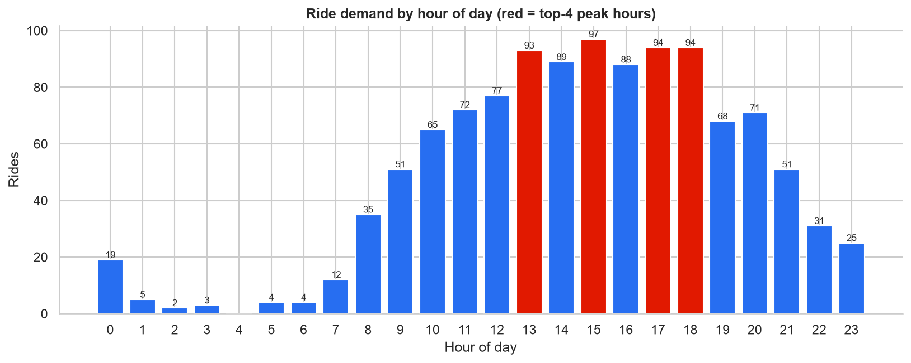

### Friday is the busiest day
Friday has 205 rides, about 20% more than any other day. Weekend days (about 149 each) are close to Wednesday and Thursday, so this rider's demand does not drop at weekends. The heatmap shows that **Friday 11 am and 1 pm** are the busiest slots of the week (24 rides each).

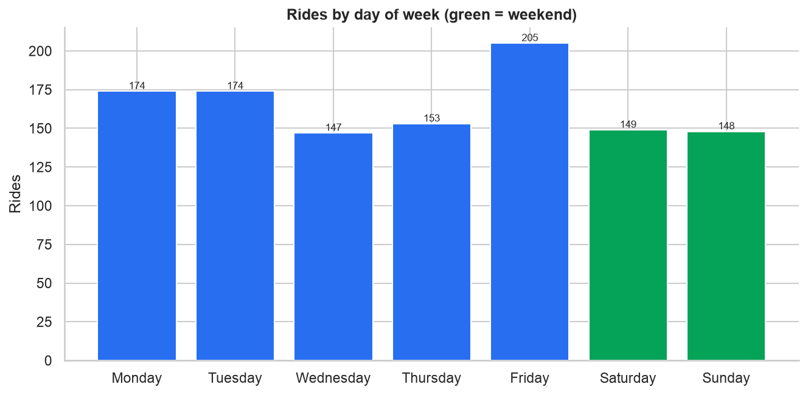


### Demand comes in bursts
December (146), August (133) and November (122) are the busiest months. September (34), May (49) and April (54) are the quietest. The daily time series shows clear busy periods and quiet periods, probably the rider's work travel schedule, rather than a smooth seasonal pattern. March and October have the most **miles** even though they do not have the most rides, because they include long inter-city trips.

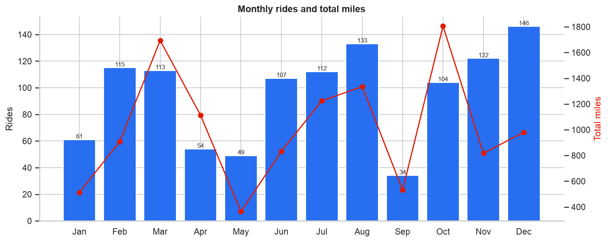
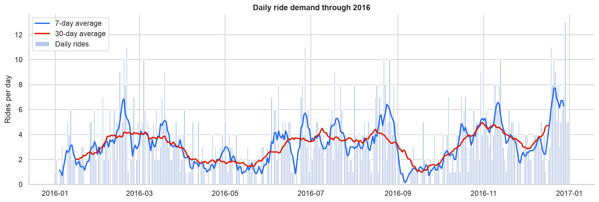
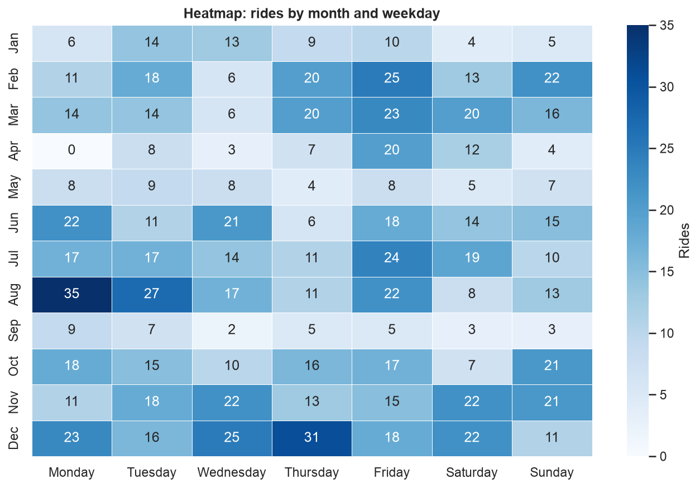

### Mostly business trips, around Cary, NC
93% of trips are Business. Among trips with a recorded purpose, the most common are Meetings (186), Meal/Entertain (160) and Errand/Supplies (128). Cary is the main pickup and drop-off area (201 pickups), followed by Morrisville and Whitebridge. 146 pickups are recorded as "Unknown Location".

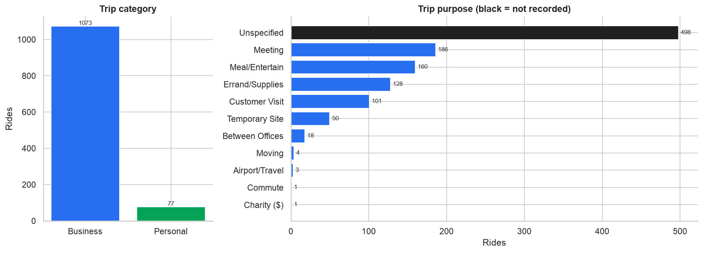
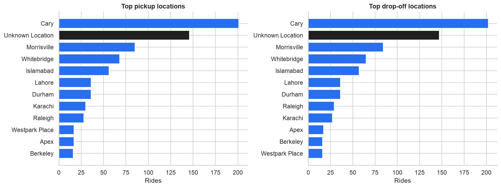

### Mostly short trips, but a few long trips add up
Most trips are 3 to 10 miles. Trips over 25 miles are only **5.6% of rides but 39% of all miles**. Customer Visits (20.7 mi on average) and Meetings (15.3 mi) are the longest trip types. Errands (4.0 mi) and meals (5.7 mi) are the shortest.

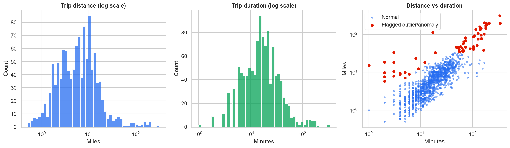
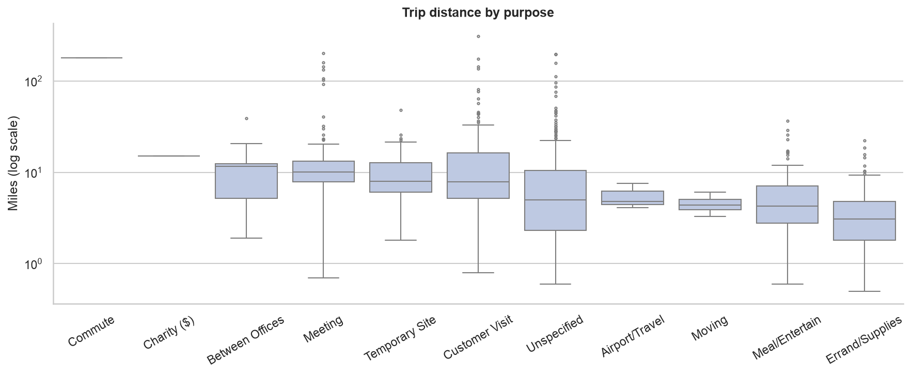

### Anomalies
19 trips have impossible average speeds (82 to 906 mph). For example, some trips cover 5 to 110 miles in 1 to 19 minutes. These are most likely logging errors. They are shown in red in the scatter plot above. The 46 very long trips (inter-city drives up to 310 miles) are real but extreme values.

### Fare trends (estimated)
- Estimated spend follows the miles driven, not the number of rides. **October ($2.8k) and March ($2.7k)** are the most expensive months because of long trips. May and September are the cheapest.
- The mean fare ($18.73) is much higher than the median ($13.00). A small number of long trips pull the average up.
- **Short trips cost the most per mile:** a median of $3.75/mile for trips under 3 miles, against $1.36/mile for trips over 25 miles. The base fare and booking fee make up most of the price of a short trip.
- The spike at 2 am in the fare-by-hour chart comes from very few rides (only 2), one of which was long. It is not a real pattern.

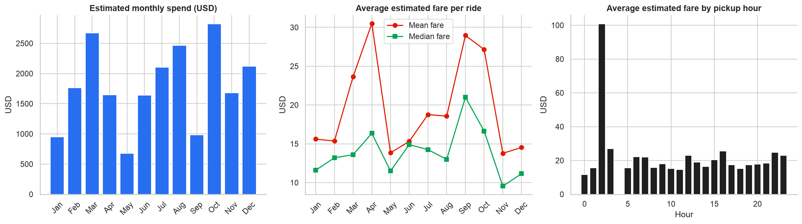
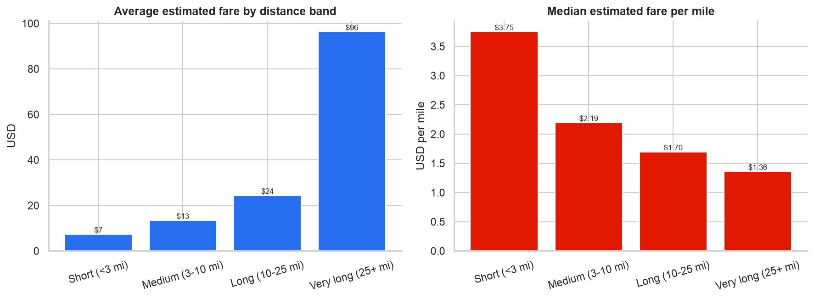

## 8. Ride-demand forecasting model

**Task:** predict the number of rides on the next day.

**Features** (only past data is used, so there is no data leakage):
- Calendar: day of week, weekend flag, month, day of month
- Lagged demand: rides 1, 2, 7 and 14 days earlier
- Rolling statistics: 7-day and 28-day mean, 7-day standard deviation, number of days with no rides in the last week

**Validation:** time-ordered split. The models train on **Jan to Oct 2016** (277 usable days after the 28-day warm-up) and are tested on **Nov to Dec 2016** (61 days they never saw). `TimeSeriesSplit` with 5 folds is used for cross-validation on the training period.

**Models:** three simple baselines (yesterday's count, the same day last week, the 7-day average) compared with Ridge Regression, Random Forest and Gradient Boosting.

| Model | Type | Test MAE (rides/day) | Test RMSE | Test R² |
|---|---|---|---|---|
| **Ridge Regression** | ML | **1.94** | **2.62** | **0.10** |
| Naive (yesterday) | baseline | 2.08 | 2.73 | 0.02 |
| Random Forest | ML | 2.12 | 2.85 | -0.07 |
| 7-day average | baseline | 2.13 | 2.74 | 0.01 |
| Gradient Boosting | ML | 2.48 | 3.13 | -0.29 |
| Seasonal naive (same day last week) | baseline | 2.57 | 3.29 | -0.43 |

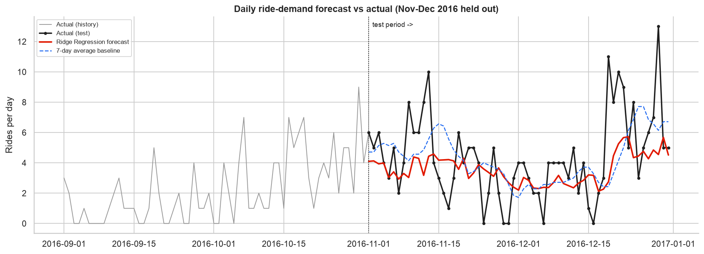
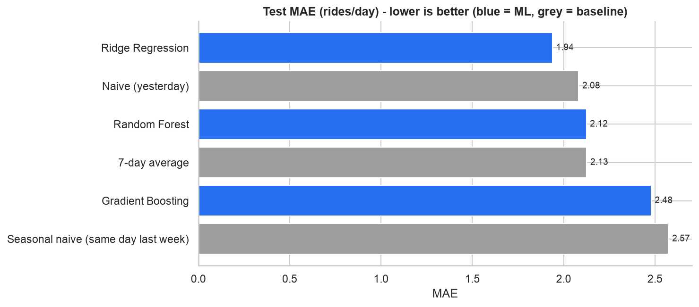

**Interpretation**
- **Ridge Regression is the best model.** It reduces the error by about 7% compared with the best baseline. Its forecast follows the overall demand level and correctly shows the late-December rise.
- The tree-based models do worse on the test period. With fewer than 300 training days they overfit, and they cannot predict values higher than anything they saw in training.
- Recent demand matters most. In the Random Forest, the 7-day rolling mean and 7-day variability are the most important features. Day of week matters less than expected.
- R² stays low because one person's daily rides are very noisy (0 to 13 rides per day, with 74 days of no rides). Large one-day spikes, such as a busy travel day, cannot be predicted from history alone. The model is good for estimating the **expected demand level** for upcoming days, not exact daily counts.

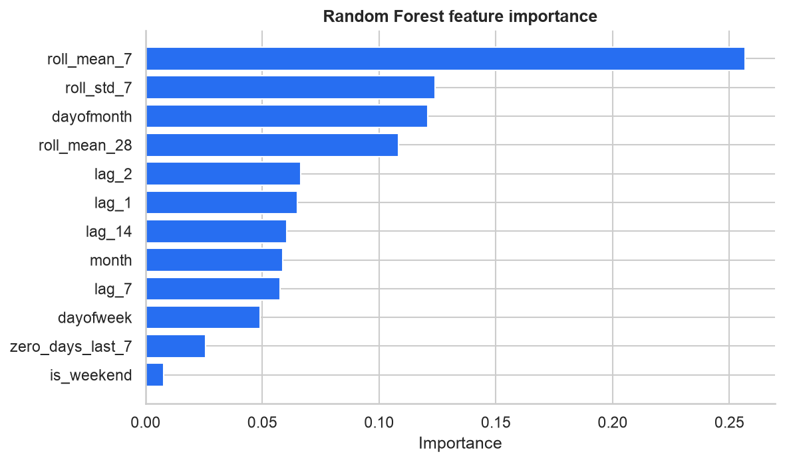

**Earlier attempt: predicting trip miles.** The first draft (`notebooks/early_work/miles_regression_first_draft.ipynb`) used a Random Forest to predict trip miles from hour, day and month. Run again on the cleaned data, it gets R² = 0.01 and MAE = 10.2 miles. That is worse than always guessing the median (MAE 9.2). Trip length depends on the destination, not the time of day, so the project switched to forecasting demand, which is the goal set in the brief.

## 9. Challenges

- **No fare data.** Pricing had to be estimated from an assumed rate card, so surge pricing and actual spend cannot be analysed.
- **A single rider.** The data shows one person's habits, not city-wide Uber demand, so the patterns cannot be applied to all users.
- **Missing purposes and locations.** 43% of trips have no purpose and 13% have "Unknown Location".
- **Data errors.** The file has a summary row, a duplicate, zero-length trips, an encoding error and impossible speeds.
- **Small, noisy time series.** One year of daily counts with many zero days limits how accurate any forecast can be.

## 10. Possible improvements

- Add **real fare data** (Uber receipts or a public NYC/Chicago trips dataset with prices) and model surge pricing.
- Add external features: **holidays, weather, the rider's calendar or travel days**.
- Use count-based models (**Poisson/Negative Binomial regression**, Prophet, SARIMA) and hierarchical forecasts (weekly → daily).
- **Geocode** the locations to build pickup/drop-off maps and origin-destination flow analysis.
- Use a **purpose classifier** (from distance, duration and time) to fill in the 498 "Unspecified" purposes.
- Collect several years of data so that yearly seasonality can be learned.

## 11. Business applications

- **Driver allocation:** place more drivers before the 1 pm to 6 pm peak and on Friday late mornings.
- **Corporate travel programmes:** 93% business use suggests offering Uber for Business accounts, expense integration and monthly reports to companies whose staff behave like this rider.
- **Pricing:** short trips are the most expensive per mile for riders. Bundled or subscription pricing for frequent short errand and meal trips could increase loyalty.
- **Demand planning:** the forecast model, even in this simple form, gives an expected demand level that can be used to plan supply and promotions.
- **Data quality monitoring:** the anomaly flags (impossible speeds, zero durations) can be used as automatic checks in trip-logging systems.

---

*Built as a GUVI data science project by Haran V S.*
